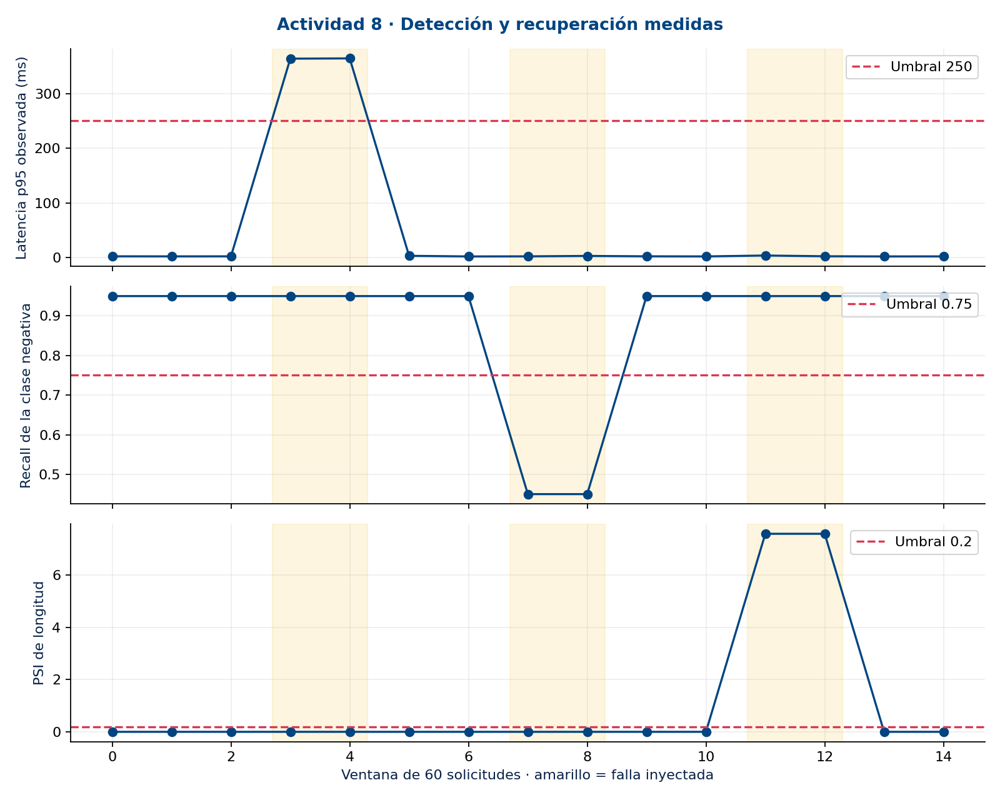

<p align="center"></p>
<h1 align="center">Actividad 8 · Observabilidad y continuidad</h1>
<p align="center">Eduardo Aburto Angulo · Gestión de proyectos de inteligencia artificial<br>Módulo 3 · Semana 10 · Temas 19 y 20</p>

## Empieza aquí

Implementé un laboratorio que detecta y recupera incidentes del servicio de clasificación de noticias de Fase II. La evidencia procede de **900 solicitudes HTTP reales**, 15 ventanas y **3 incidentes simulados recuperados**. Las fallas son controladas; no corresponden a tráfico bancario de producción.

| Quiero revisar | Abrir |
|---|---|
| Documento técnico y decisiones | [PDF](documentos/Documento_tecnico.pdf) · [Word editable](documentos/Documento_tecnico.docx) |
| Evidencia de implementación y MLflow | [PDF](documentos/Evidencia_implementacion.pdf) · [Exportación real MLflow](evidencias/mlflow_export.json) |
| Incidentes y ejecución de runbooks | [PDF](documentos/Simulacion_incidentes.pdf) · [Pasos registrados](evidencias/runbook_steps.json) |
| Tablero Streamlit | [Aplicación](app.py) · instrucciones debajo |
| Alertas y procedimientos | [Configuración](config/alertas.json) · [Runbooks](runbooks/README.md) |
| Validar los resultados | [Verificador](scripts/verify_evidence.py) · [Resultados originales](evidencias/summary.json) |



## Editar en Google Docs

[Documento técnico](https://docs.google.com/document/d/1-DStylkW7mW17Qdpj9g-uxETDyGbEEtasdzIzSjp1Mg/edit) · [Evidencia de implementación](https://docs.google.com/document/d/1kfE5N71RCpxyjlwEpxE_tJGuRY7CpFboSdRzApfX6qU/edit) · [Simulación de incidentes](https://docs.google.com/document/d/1EKSEgWnlxt1bbbTSyjD0Cb_J-xvNY3GnGHlA1ACmJwM/edit). Copias editables en la cuenta del autor; los PDF y Word de este repositorio son accesibles públicamente.

## Resultado que conviene interpretar

- **Disponibilidad: 900/900 solicitudes exitosas.** Presupuesto permitido: 9 fallas; consumido: 0.
- **Latencia: 120/900 solicitudes lentas.** Presupuesto permitido: 9; consumido: 120. El SLO agregado de 99 % **no se cumplió**, aunque terminó recuperado.
- **Tres alertas emitidas frente a seis avisos por ventanas con incumplimiento:** 50 % menos notificaciones respecto de avisar cada ventana. Esto no mide una tasa de falsos positivos.
- Detección media: **14.683 s**; recuperación media desde detección hasta dos ventanas sanas: **0.273 s**. Son tres incidentes locales y secuenciales, no compromisos de producción.
- Calidad del canario normal: precisión 0.9048, recall 0.9500 y F1 0.9268. Son 60 textos históricos repetidos; no una evaluación independiente ni una promesa de rendimiento financiero.

## Cobertura de la rúbrica

| Criterio de 25 puntos | Implementación verificable |
|---|---|
| Métricas, logs y trazas | [Instrumentación](observabilidad/service.py), [métricas](observabilidad/monitor.py), [logs](evidencias/logs.jsonl), [spans](evidencias/traces.jsonl) correlacionados por trace_id |
| Alertas SLO y error budgets | 99 %, ≤250 ms, burn rate >2, dos ventanas, prioridades P1–P3 y deduplicación; [eventos](evidencias/alerts.json) |
| Simulación y respuesta | Latencia, degradación de salida y drift de longitud; [incidentes](evidencias/incidents.json) y ejecución de runbooks |
| Documentación y automatización | Tres reportes, rollback de configuración, cuarentena y escalamiento local; no reentrenamiento ni operaciones financieras automáticas |

## Reproducir desde cero

Python 3.12. Ejecutar desde la raíz del repositorio. La instalación descarga paquetes; el laboratorio usa el modelo y dataset versionados, sin servicios de pago ni claves externas.

```bash
git clone https://github.com/eduardoaburtoa/actividad8-observabilidad-portafolios.git
cd actividad8-observabilidad-portafolios
python3.12 -m venv .venv
source .venv/bin/activate
python -m pip install -r requirements.txt
python -m pytest pruebas -q
python scripts/verify_evidence.py
python scripts/run_lab.py
python scripts/verify_evidence.py
python scripts/figures.py
```

El laboratorio tarda aproximadamente un minuto, inicia una API en un puerto local libre y la detiene al terminar. Genera claves aleatorias temporales y conserva cada sesión en `runtime/`. Actualiza las evidencias: guarda una copia si deseas conservar la corrida publicada. No ejecutar dos laboratorios simultáneos en la misma carpeta. Una máquina lenta puede afectar la latencia y generar alertas adicionales; eso es una medición real, no un motivo para modificar resultados a mano.

## Abrir Streamlit y MLflow

```bash
python -m streamlit run app.py --server.address 127.0.0.1 --server.port 8518
```

Abre http://127.0.0.1:8518. El tablero refresca cada tres segundos. Para observar cambios, ejecuta `run_lab.py` en otra terminal. Sin laboratorio activo presenta la última corrida guardada. En Streamlit Community Cloud se puede seleccionar `app.py` para visualizar la evidencia publicada; ese despliegue no ejecuta incidentes por sí mismo.

Después de ejecutar el laboratorio:

```bash
python -m mlflow ui --backend-store-uri sqlite:///runtime/mlflow.db --host 127.0.0.1 --port 5088
```

Abre http://127.0.0.1:5088 y el experimento `Actividad8_observabilidad_portafolios`. Verás parámetros, métricas por paso y artefactos. El identificador de la corrida publicada es `c0a8fa3f79b84eb4bec63d70b674bf32`; cada reproducción obtiene uno nuevo. La base SQLite local no se publica: [exportación portable](evidencias/mlflow_export.json) y archivos JSONL permiten revisar resultados sin MLflow.

## Arquitectura y límites

Cliente canario → API FastAPI instrumentada → SVM calibrada congelada → logs y spans JSONL → monitor SLO y drift → alertas y runbooks → MLflow y Streamlit.

Las trazas contienen spans padre e hijo locales, no una instalación de OpenTelemetry Collector ni propagación distribuida. Las métricas de calidad necesitan etiquetas; sin ellas, una alerta existente no se da por resuelta. El PSI sólo examina longitud textual y no demuestra concept drift. Las ventanas son de solicitudes, no un SLO mensual.

Se conserva el modelo de [Actividad 6](https://github.com/eduardoaburtoa/actividad6-evaluacion-portafolios) servido en [Fase II](https://github.com/eduardoaburtoa/fase2-despliegue-portafolios), revisión `b6ecb7a0e6b01ece989369b7b67178fe7d7cc2a4`. Su hash está en [manifest](modelos/manifest.json), umbral 0.20 y lengua inglés. Un rollback aquí restaura la configuración de servicio; no sustituye pesos ni reentrena.

## Contexto bancario como anexo

Mi propósito es preparar revisiones de portafolio con señales trazables y revisión del banquero. Los [150 clientes ficticios](contexto/) se conservan como continuidad didáctica; no alimentan el monitor ni son datos personales reales. La comisión de 1 % por compra y 1 % por venta es un supuesto académico, no una tarifa verificada de BBVA. El clasificador no estima rendimientos, no recomienda cambiar fondos y no ejecuta operaciones. El foco evaluado de esta entrega es la confiabilidad operativa.

## Organización

`observabilidad/`: instrumentación y monitor · `config/`: reglas · `scripts/`: laboratorio, gráficas y verificación · `evidencias/`: mediciones reales exportadas · `runbooks/`: respuesta · `pruebas/`: pruebas automatizadas · `documentos/`: entregables · `backend/`, `modelos/`, `datos/`, `frontend/` y `contexto/`: continuidad de Fase II.

[Historial y decisiones](CHANGELOG.md) · [Aviso de uso académico](AVISO.md)
