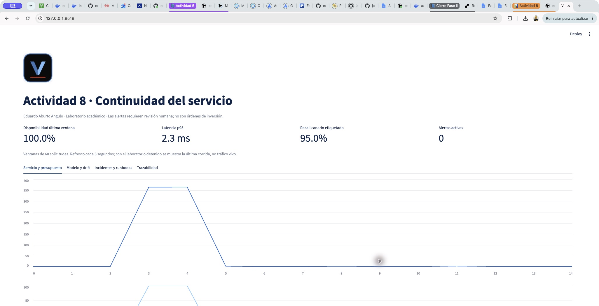
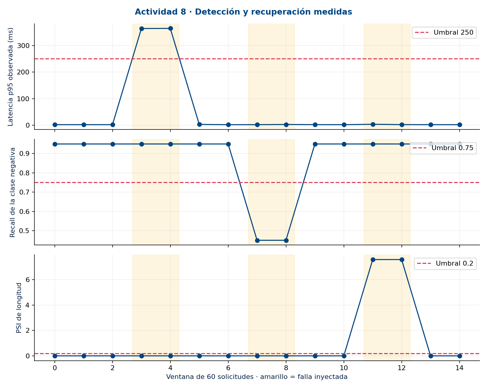

# Documento técnico

**Actividad 8 · Eduardo Aburto Angulo**

Diseño de indicadores, alertas, dashboards, runbooks, drift y respuesta automatizada.

[Portada del proyecto](../../README.md) · [Todos los documentos](../README.md)

> Laboratorio académico local. Los resultados documentan fallas simuladas; no acreditan operación bancaria en producción.

## En esta página

- [Propósito y decisión operativa](#proposito-y-decision-operativa)
- [Continuidad y alcance](#continuidad-y-alcance)
- [Arquitectura implementada](#arquitectura-implementada)
- [Indicadores y contratos de medición](#indicadores-y-contratos-de-medicion)
- [SLO y presupuesto de error](#slo-y-presupuesto-de-error)
- [Alertas y presupuesto de error (error budget)](#alertas-y-presupuesto-de-error-error-budget)
- [Alertas y reducción de ruido](#alertas-y-reduccion-de-ruido)
- [Data drift y límites del diagnóstico](#data-drift-y-limites-del-diagnostico)
- [Dashboard para decidir](#dashboard-para-decidir)
- [Dashboard: lectura de evidencia visual](#dashboard-lectura-de-evidencia-visual)
- [Runbooks de respuesta a incidentes](#runbooks-de-respuesta-a-incidentes)
- [Respuesta automatizada y gobernanza](#respuesta-automatizada-y-gobernanza)
- [Mantenimiento y deuda técnica](#mantenimiento-y-deuda-tecnica)
- [Evidencia y conclusión](#evidencia-y-conclusion)
- [Contexto de negocio complementario](#contexto-de-negocio-complementario)
- [Tiempos por incidente y exposición antes de detectar](#tiempos-por-incidente-y-exposicion-antes-de-detectar)
- [Conclusiones](#conclusiones)
- [Fundamento de las decisiones](#fundamento-de-las-decisiones)
- [Referencias](#referencias)
- [Cobertura de la rúbrica](#cobertura-de-la-rubrica)

## Propósito y decisión operativa

Como banquero Sr., necesito saber cuándo una señal deja de ser confiable antes de incorporarla a una revisión de portafolio. En esta entrega implementé observabilidad para la API de clasificación de noticias de Fase II. Mi decisión es mantener la solución como laboratorio académico: las tres fallas simuladas se detectaron y recuperaron, pero la corrida completa incumplió el presupuesto de latencia. La recuperación no equivale a acreditar producción.

El objetivo verificable fue instrumentar métricas, logs y trazas; detectar tres incidentes mediante reglas persistentes; ejecutar respuestas reversibles y conservar evidencia en MLflow. Ejecuté 900 solicitudes HTTP en 15 ventanas de 60 observaciones. No usé datos de clientes reales ni ejecuté movimientos de inversión.

## Continuidad y alcance

Conservé la SVM calibrada y el umbral 0.20 de Actividad 6. La clase positiva significa noticia negativa y el idioma soportado es inglés. Fase II aporta la API FastAPI. La referencia de código es b6ecb7a0e6b01ece989369b7b67178fe7d7cc2a4; el manifest del modelo permite comprobar sus bytes. Esta actividad evalúa la operación del servicio y no vuelve a seleccionar modelos con el test.

Utilicé 60 textos del test retrospectivo: 20 negativos y 40 no negativos, seleccionados con semilla 42. Repito esa muestra en cada ventana para aislar el efecto de las fallas. Las etiquetas son conocidas y la distribución no representa la cartera ni tráfico real. Las métricas del canario no sustituyen las del test completo de 452 registros.

## Arquitectura implementada

El cliente envía solicitudes a la API local instrumentada. El middleware registra estado, duración, versión y trace_id sin guardar noticias ni claves. El monitor agrega ventanas, calcula SLI y PSI y dispara acciones locales. MLflow registra parámetros, métricas por paso y artefactos; Streamlit actualiza la vista cada tres segundos. Los spans padre e hijo son locales en JSONL; no implementé un Collector de OpenTelemetry ni propagación entre servicios.

## Indicadores y contratos de medición

| Indicador | Definición y uso |
| --- | --- |
| Disponibilidad | Respuestas HTTP 200 / solicitudes válidas del canario. Timeouts y respuestas no exitosas consumen presupuesto. |
| Latencia | Tiempo cliente de ida y vuelta; p95 por ventana. SLI: proporción de solicitudes exitosas con duración ≤250 ms. |
| Tráfico y recursos | Solicitudes / segundo; memoria RSS y CPU del proceso. 512 MB es presupuesto de planificación, no límite impuesto. |
| Calidad | Precisión, recall y F1 de noticia negativa, sólo sobre respuestas exitosas con etiqueta. Mínimo 15 negativos por ventana. |
| Drift | PSI de longitud en palabras frente al canario inicial; bins 0,10,20,30,50,1000000 y suavizado +0.5. |
| Logs y trazas | Timestamp, ruta, método, estado, duración, modo y revisión. trace_id une solicitud, log y spans con padre, inicio y fin. |

El campo exportado server_errors conserva su nombre histórico, pero cuenta cualquier respuesta no exitosa del canario, no sólo errores 5xx. El control de laboratorio exige una clave distinta de la API y LAB_MODE=1. El proceso escucha sólo en loopback. Las pruebas comprueban que texto y claves no se filtran al log.

## SLO y presupuesto de error

Definí SLO de disponibilidad de 99 % y SLO de latencia de 99 % de solicitudes ≤250 ms. Para N solicitudes, presupuesto permitido = N × (1 − SLO); consumo = número de solicitudes malas; saldo = permitido − consumo. Burn rate = fracción mala / (1 − SLO). Son ventanas por solicitudes del laboratorio, no ventanas mensuales de producción ni un SLA contractual.

En 900 solicitudes, cada presupuesto permite 9 eventos. La disponibilidad consumió cero. La latencia consumió 120: saldo −111 y cumplimiento agregado 86.67 %. El burn agregado fue 13.33 veces la tasa permitida. El servicio volvió a su condición normal después de la intervención, pero ese consumo permanece registrado.

## Alertas y presupuesto de error (error budget)

El presupuesto de error (error budget) es el número de fallas que tolera el SLO dentro del conjunto observado: N × (1 − SLO). Distingo lo permitido, lo consumido y el saldo; aquí N=900 solicitudes, no un mes de servicio.

| SLO | Permitido | Consumido | Saldo |
| --- | --- | --- | --- |
| Disponibilidad 99 % | 9 | 0 | 9 |
| Latencia 99 % ≤250 ms | 9 | 120 | -111 |

El SLO de latencia no se cumplió. La configuración se recuperó y las últimas dos ventanas fueron sanas, pero recuperar el servicio no restituye el presupuesto gastado. El burn rate divide la fracción de fallas entre 0.01: es un multiplicador del ritmo tolerado. Elegí >2.0 para detectar un consumo superior al doble de ese ritmo; es una decisión de laboratorio, no un valor óptimo demostrado. Exijo dos ventanas consecutivas de 60 solicitudes para reducir aperturas por fluctuaciones aisladas.

La persistencia y deduplicación redujeron seis avisos crudos a tres notificaciones emitidas: 50 % menos. Esta comparación mide volumen de avisos, no una tasa de falsos positivos. Priorizar y verificar la recuperación protege la continuidad sin ocultar el incumplimiento histórico.

## Alertas y reducción de ruido

| Regla | Disparador y prioridad | Respuesta |
| --- | --- | --- |
| Disponibilidad | Burn >2 en dos ventanas de 60; P1 | Diagnóstico y rollback de configuración; escalamiento si persiste |
| Latencia | Burn >2 en dos ventanas de 60; P2 | Restaurar modo normal y verificar dos ventanas |
| Calidad | Recall <0.75 o F1 <0.65 con etiquetas suficientes; P2 | Revertir salida alterada y revisar calidad |
| Drift | PSI >0.20 durante dos ventanas; P3 | Cuarentena del lote sintético y revisión local |

La persistencia evita avisar por un único incumplimiento. La deduplicación emite una sola apertura por regla activa; exige dos ventanas sanas para cerrar. Si faltan etiquetas, una alerta de calidad permanece abierta. Un P1 no queda silenciado por un P2. El mínimo de 60 solicitudes evita interpretar lotes incompletos. Los umbrales son decisiones de laboratorio y requieren recalibración con historia operativa.

El motor observó seis ventanas que habrían generado aviso individual y emitió tres aperturas: reducción del 50 % frente a esa política simple. No infiero una tasa de falsos positivos ni una validación estadística con tres incidentes. En producción incorporaría ventanas temporales cortas y largas y guardias; aquí la persistencia usa dos ventanas consecutivas de solicitudes.

## Data drift y límites del diagnóstico

Calculo PSI = suma de (q − p) × ln(q/p), usando proporciones suavizadas. El experimento repite ocho veces cada texto para desplazar la longitud. La alerta indica cambio de entrada, no prueba pérdida de capacidad predictiva. No cubre cambios semánticos de igual longitud, idioma, etiquetas ni concept drift. Para producción añadiría seguimiento de embeddings y calidad con etiquetas retrasadas, por segmentos y con tamaño muestral suficiente.

## Dashboard para decidir

La vista Servicio presenta disponibilidad, p95, burn rate, presupuesto, tráfico y memoria. Modelo muestra precisión, recall, F1 y PSI. Incidentes permite examinar aperturas, cierres y pasos del runbook. Trazabilidad expone resumen, corrida MLflow y spans. Cuando el laboratorio está detenido, el tablero indica que muestra la última corrida; no presenta esos datos como tráfico vivo.

| Panel / refresco | Indicadores / condición crítica | Decisión del operador |
| --- | --- | --- |
| Servicio y presupuesto / 3 s | Disponibilidad, p95, burn, saldo, tráfico y RSS. Burn >2 en dos ventanas; presupuesto negativo evidencia incumplimiento. | Revisar RB01, distinguir latencia de disponibilidad y preservar el consumo histórico. RSS de 512 MB es planificación, sin alerta automática. |
| Modelo y drift / 3 s | Precisión, recall, F1 y PSI. Recall <0.75 o F1 <0.65; PSI >0.20; persistencia de dos ventanas. | RB02 revisa salida y etiquetas; RB03 aparta el lote alterado. No inferir concept drift de la longitud. |
| Incidentes y runbooks / 3 s | Estado, prioridad, apertura, cierre y seis etapas. Incidente abierto exige intervención. | Priorizar P1 antes de P2/P3, verificar dos ventanas sanas y escalar si no hay recuperación. |
| Trazabilidad / 3 s | Resumen, corrida MLflow y spans correlacionados por trace_id. No tiene umbral de color. | Reconstruir la solicitud y versión para auditar la causa sin exponer noticias ni claves. |

La columna de condición crítica define cuándo intervenir; la interfaz actual no pinta automáticamente todos los umbrales en rojo. El refresco de tres segundos relee archivos: no genera tráfico ni nuevas mediciones. Distingo disponibilidad de la vista y frescura de los datos antes de decidir sobre continuidad del servicio.

## Dashboard: lectura de evidencia visual

Figura 1. Dashboard Streamlit: servicio y presupuesto; última corrida local. Fuente: elaboración propia, laboratorio local; no tráfico bancario.

Figura 2. Mediciones originales por ventana: latencia, calidad y drift de longitud. Fuente: elaboración propia, laboratorio local; no tráfico bancario.

Leo primero el estado actual y después la serie histórica. Cero alertas al cierre no borra las ventanas degradadas; la serie permite comprobar el daño y su recuperación.

## Runbooks de respuesta a incidentes

| Regla y disparador | Diagnóstico y corrección | Cierre y escalamiento |
| --- | --- | --- |
| RB01 · P2 latencia / P1 disponibilidad. Burn >2 en dos ventanas consecutivas de 60 solicitudes. | Confirmar estado HTTP, p95, modo, revisión y hash; correlacionar trace_id. Restaurar mode=normal sin cambiar el modelo. | Cerrar tras dos ventanas sanas. Si persiste después de la corrección, mantener abierto, detener uso de la salida y escalar al operador. |
| RB02 · P2. Recall <0.75 o F1 <0.65 en dos ventanas de 60, con ≥15 negativos etiquetados por ventana. | Comprobar etiquetas, versión y umbral 0.20. Revertir la inversión de probabilidad simulada con mode=normal. | Dos ventanas recuperadas con etiquetas suficientes. Sin etiquetas no cerrar; solicitar etiquetado. Si persiste, retirar resultados y escalar al responsable del modelo. |
| RB03 · P3. PSI de longitud >0.20 durante dos ventanas de 60 solicitudes. | Revisar bins, muestra y origen. Poner en cuarentena el lote sintético y restablecer la entrada de referencia. | Dos ventanas con PSI normal. Si no se recupera, conservar cuarentena y ticket local de revisión; no reentrenar automáticamente. |

El ciclo registrado contiene seis etapas: prepare verifica alcance, referencia y versión; detect identifica la regla; diagnose confirma la causa; correct ejecuta una acción reversible; verify contrasta dos ventanas sanas; postmortem documenta causa y prevención. Exijo dos ventanas sanas para evitar cerrar por una recuperación aislada. Con etiquetas insuficientes, la calidad permanece sin confirmar. La versión extensa se conserva en [runbooks/README.md](../../runbooks/README.md); este apartado contiene las decisiones necesarias para interpretar la respuesta por sí solo.

## Respuesta automatizada y gobernanza

Los runbooks completos están en [runbooks/README.md](../../runbooks/README.md). Cada ejecución registra preparación, detección, diagnóstico, corrección, verificación y postmortem. RB01 restaura la configuración ante latencia; RB02 revierte la alteración simulada de probabilidades; RB03 aparta el lote de entrada alterado y registra escalamiento local. El rollback no cambia el artefacto del modelo. El reentrenamiento requiere diagnóstico, evaluación y autorización humana y no se ejecutó.

Si la corrección no recupera dos ventanas, el procedimiento mantiene el incidente abierto y escala al operador; no establece reintentos indefinidos. Los roles propuestos son operador MLOps para continuidad, propietario del modelo para validación y banquero para uso de señales. El ticket de escalamiento es un registro local, no un envío a un servicio externo de guardia.

| Incidente | Detección s | Recuperación s | Estado |
| --- | --- | --- | --- |
| latency | 43.457 | 0.291 | resolved |
| degradation | 0.295 | 0.268 | resolved |
| drift | 0.298 | 0.261 | resolved |

MTTD se mide desde inyección a detección y MTTR desde detección hasta cierre verificado. Las medias fueron 14.683 s y 0.273 s. La latencia tarda más en detectarse porque 120 solicitudes secuenciales acumulan el retraso inyectado de 350 ms; las otras fases corren rápidamente en el mismo host. Estos tiempos no son expectativas de recuperación para una operación distribuida.

## Mantenimiento y deuda técnica

Versioné configuración y scripts, conservé hash de modelo, evidencia portable y pruebas de controles. MLflow usa SQLite local; cada reproducción obtiene una corrida distinta. La promoción productiva requeriría almacenamiento central de telemetría, autenticación y permisos por rol, retención, alertamiento a guardia, control transaccional de acciones y pruebas de carga. El laboratorio no debe exponerse como endpoint público.

Propongo revisar SLO y umbrales mensualmente con el propietario del servicio; ensayar runbooks tras cambios de modelo; conservar incidentes y decisiones en un registro auditado. La propuesta de retención es 30 días de telemetría operativa y 90 de incidentes, sujeta a política institucional. No se ha implementado borrado automático ni aprobación regulatoria.

## Evidencia y conclusión

Entrego scripts ejecutables, nueve pruebas automatizadas, un verificador que recalcula métricas y correlaciona trazas, tres documentos y un tablero Streamlit. MLflow registró la corrida c0a8fa3f79b84eb4bec63d70b674bf32 con estado FINISHED. Las capturas y exportaciones se presentan en Evidencia de implementación; las cronologías en Simulación de incidentes.

Mi conclusión es que el prototipo permite detectar y atender las fallas ensayadas de forma trazable. Conservo explícitamente el incumplimiento agregado de latencia y los límites de la muestra. Mi criterio como banquero es detener el uso de una señal dudosa y solicitar revisión, antes de convertir un resultado técnico en una acción sobre el patrimonio de un cliente.

## Contexto de negocio complementario

La continuidad del proyecto conserva 150 personajes ficticios con posiciones de 5 a 20 millones de pesos. Su función es didáctica: dar personalidad a escenarios sin usar datos reales. La comisión de 1 % por compra y 1 % por venta es un supuesto académico; no constituye una tarifa verificada de BBVA. Las comisiones de fondos dependen de documentación y series vigentes. No uso esos supuestos para medir éxito del monitor ni para recomendar cambios de fondos.

## Tiempos por incidente y exposición antes de detectar

| Caso | Detección s | Recuperación s | Solicitudes lentas antes de detectar |
| --- | --- | --- | --- |
| INC-001 | 43.457 | 0.291 | 120 |
| INC-002 | 0.295 | 0.268 | 0 |
| INC-003 | 0.298 | 0.261 | 0 |

| Resumen | Detección s | Recuperación s |
| --- | --- | --- |
| Media | 14.683 | 0.273 |
| Mediana | 0.298 | 0.268 |
| Máximo | 43.457 | 0.291 |

Por incidente reporto tiempo de detección y recuperación; MTTD y MTTR son sus medias entre incidentes. La mediana describe mejor el centro de estos tres ensayos, mientras el máximo revela la exposición más prolongada. Ninguno permite estimar tiempos productivos con una muestra tan pequeña.

La asimetría se explica por solicitudes secuenciales: dos ventanas de 60 con 350 ms adicionales acumulan al menos 42 s de demora inyectada, más inferencia y medición. Calidad y drift también esperan dos ventanas; terminan antes porque no añaden esa espera por solicitud. No son alertas instantáneas.

Antes de detectar INC-001 ya habían finalizado 120 solicitudes lentas. Son 60 textos repetidos dos veces, no 120 clientes. Como banquero, ese volumen de respuestas demoradas es el costo operativo que el promedio por sí solo oculta. El cálculo usa los timestamps originales entre inyección y detección; [scripts/analyze_incidents.py](../../scripts/analyze_incidents.py) deja resultados y hashes de entrada en [evidencias/incident_analysis.json](../../evidencias/incident_analysis.json).

Propongo evaluar ventanas más cortas para latencia y un disparador rápido junto al persistente. No lo implementé ni atribuyo mejoras medidas: anticipar avisos puede reducir exposición, a costa de más ruido y mayor carga para el operador. Requeriría comparar políticas con tráfico representativo antes de cambiar la configuración.

## Conclusiones

Mi criterio después de veinte años en banca es que la confianza exige reconocer los límites del servicio. Con ánimo de mejorar su continuidad, conservaré el incumplimiento de latencia como punto de partida para evaluar una alerta más rápida; no presentaré la recuperación local como acreditación productiva.

La IA no sustituye el criterio del banquero; lo aumenta.

## Fundamento de las decisiones

Relaciono indicadores y respuesta con los temas del curso (Universidad Tecmilenio, 2026). El presupuesto y la propuesta de ventanas rápidas se apoyan en Google (2018), sin atribuir al laboratorio la implementación de ventanas temporales productivas. Registro parámetros, métricas y artefactos conforme al propósito de Tracking (MLflow, s. f.).

La API utiliza FastAPI (s. f.) y el refresco del tablero usa fragmentos de Streamlit (s. f.). Las métricas de clasificación siguen las definiciones de scikit-learn (s. f.); el corpus financiero se atribuye a Malo et al. (2014). OpenTelemetry (s. f.) aporta el marco conceptual de spans y relaciones padre-hijo: aquí conservé instrumentación local propia, sin desplegar su plataforma distribuida.

## Referencias

FastAPI. (s. f.). FastAPI. Recuperado el 6 de noviembre de 2026, de https://fastapi.tiangolo.com/

Google. (2018). Alerting on SLOs. En The site reliability workbook. https://sre.google/workbook/alerting-on-slos/

Malo, P., Sinha, A., Korhonen, P., Wallenius, J., & Takala, P. (2014). Good debt or bad debt: Detecting semantic orientations in economic texts. Journal of the Association for Information Science and Technology, 65(4), 782–796. https://doi.org/10.1002/asi.23062

MLflow. (s. f.). MLflow Tracking. Recuperado el 6 de noviembre de 2026, de https://mlflow.org/docs/latest/ml/tracking/

OpenTelemetry. (s. f.). Traces. Recuperado el 6 de noviembre de 2026, de https://opentelemetry.io/docs/concepts/signals/traces/

scikit-learn. (s. f.). Metrics and scoring: Quantifying the quality of predictions. Recuperado el 6 de noviembre de 2026, de https://scikit-learn.org/stable/modules/model_evaluation.html

Streamlit. (s. f.). st.fragment. Recuperado el 6 de noviembre de 2026, de https://docs.streamlit.io/develop/api-reference/execution-flow/st.fragment

Universidad Tecmilenio. (2026). Gestión de proyectos de inteligencia artificial: Temas 19 y 20 y rúbrica de la Actividad 8 [Material del curso].

## Cobertura de la rúbrica

| Criterio (25 % cada uno) | Apartado de este documento | Ir al apartado |
| --- | --- | --- |
| Diseño de monitorización y observabilidad | Indicadores y contratos de medición | [Leer sección](#indicadores-y-contratos-de-medicion) |
| Diseño y aplicación de alertas inteligentes | Alertas y presupuesto de error (error budget) | [Leer sección](#alertas-y-presupuesto-de-error-error-budget) |
| Simulación de incidentes y uso de runbooks | Runbooks de respuesta a incidentes | [Leer sección](#runbooks-de-respuesta-a-incidentes) |
| Documentación de la respuesta automatizada | Respuesta automatizada y gobernanza | [Leer sección](#respuesta-automatizada-y-gobernanza) |

En esta edición web, la tabla de cobertura enlaza directamente al apartado correspondiente. Las descargas conservan su paginación original.

Este documento fue estructurado precisamente para cubrir esos 4 apartados de forma explícita y verificable.

---

Descargas y declaración de uso de IA

[Descargar PDF](../Documento_tecnico.pdf) · [Descargar Word](../Documento_tecnico.docx)

La declaración corresponde a la entrega original; esta edición cambia su presentación para lectura en GitHub.

| Herramienta de IA utilizada | ¿La usaste? | Propósito / Descripción de uso |
| --- | --- | --- |
| ChatGPT / OpenAI | Sí | ChatGPT/Codex: apoyo en programación, ejecución de pruebas, simulaciones locales, documentación y revisión visual. Las mediciones proceden de ejecuciones reales con fallas inyectadas. |
| Claude (Anthropic) | Sí | Revisión técnica independiente de la entrega: clonado del repositorio, ejecución propia de [scripts/verify_evidence.py](../../scripts/verify_evidence.py) —que recalcula las 900 solicitudes, las 15 ventanas, las métricas por ventana, la correlación de trazas y los pasos de runbook— y de las 9 pruebas automatizadas; verificación del SHA256 del modelo contra el manifiesto y la Actividad 6; cotejo de los entregables contra los cuatro criterios de la rúbrica y los apartados exigidos; y elaboración de las instrucciones de corrección. No redactó el código ni los documentos. |
| Gemini (Google) | Antecedentes | Herramienta mencionada en actividades previas; no se atribuye ejecución nueva en Actividad 8. |
| Copilot (Microsoft) | Antecedentes | Herramienta mencionada en actividades previas; no se atribuye ejecución nueva en Actividad 8. |
| Otra (especifica): | Antecedentes | Herramienta mencionada en actividades previas; no se atribuye ejecución nueva en Actividad 8. |

### Continuar la lectura

[2. Evidencia de implementación](../02-evidencia-implementacion/README.md) · [3. Simulación de incidentes](../03-simulacion-incidentes/README.md)

[Volver al índice](../README.md)
