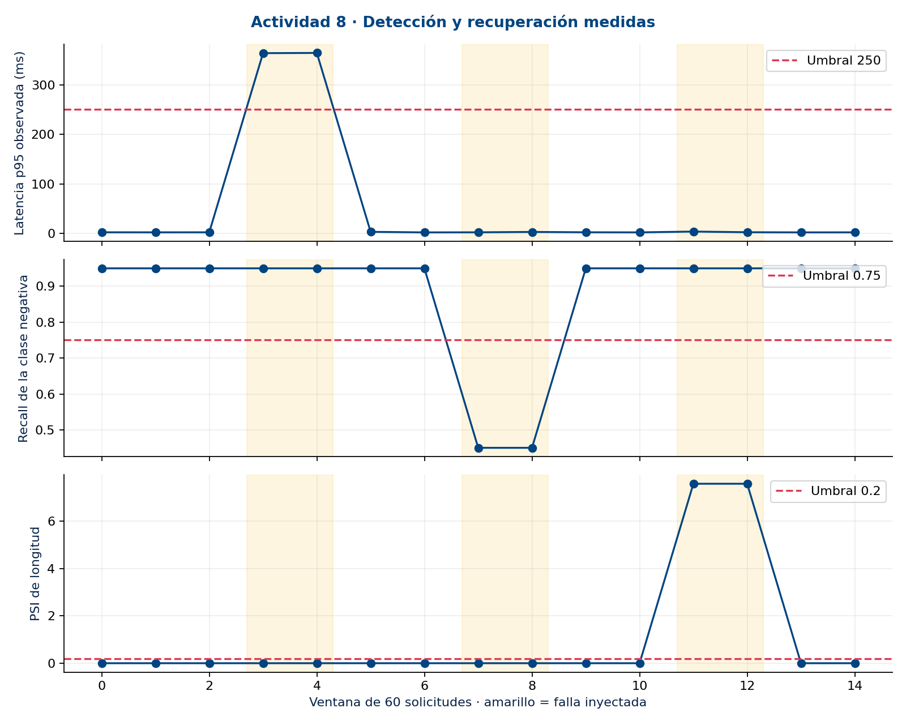
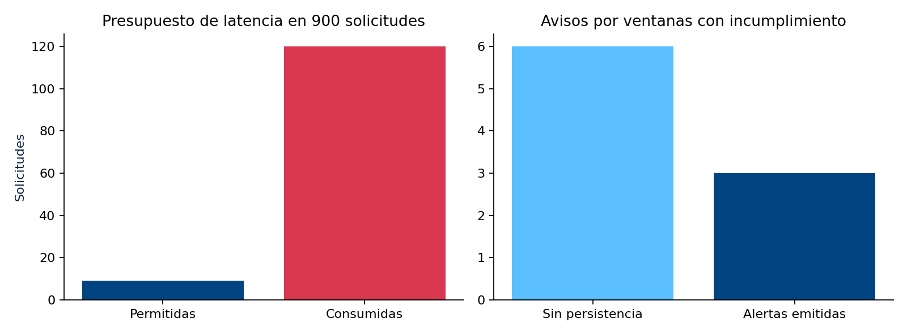
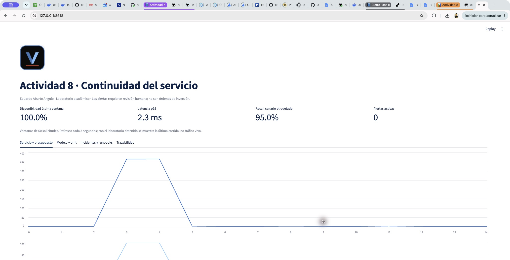
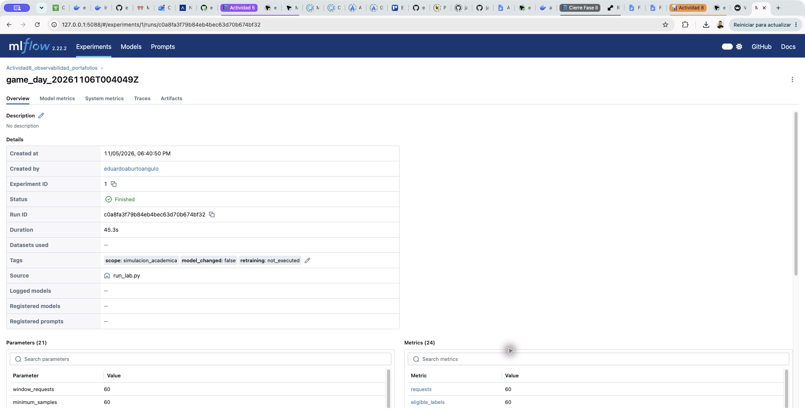
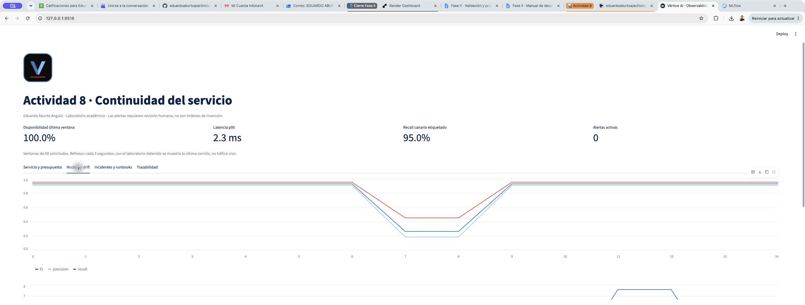
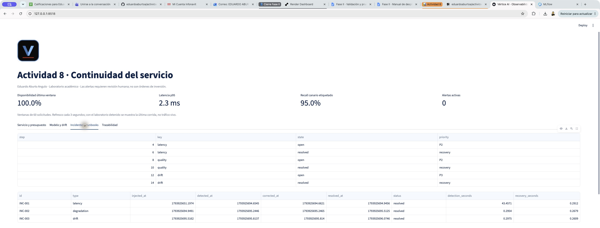
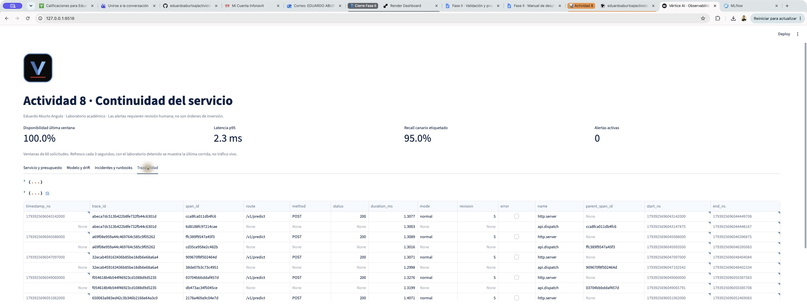

# Evidencia de implementación · Métricas y dashboards

**Actividad 8 · Eduardo Aburto Angulo**

Capturas de Streamlit y MLflow, métricas y archivos verificables.

[Portada del proyecto](../../README.md) · [Todos los documentos](../README.md)

> Laboratorio académico local. Los resultados documentan fallas simuladas; no acreditan operación bancaria en producción.

## En esta página

- [Qué demuestra esta evidencia](#que-demuestra-esta-evidencia)
- [Alertas y presupuesto de error (error budget)](#alertas-y-presupuesto-de-error-error-budget)
- [Presupuesto y política de notificación](#presupuesto-y-politica-de-notificacion)
- [Registro real en MLflow](#registro-real-en-mlflow)
- [Verificación y reproducción](#verificacion-y-reproduccion)
- [Captura del registro en MLflow](#captura-del-registro-en-mlflow)
- [Recorrido del dashboard: cuatro vistas](#recorrido-del-dashboard-cuatro-vistas)
- [Recorrido: incidentes y trazabilidad](#recorrido-incidentes-y-trazabilidad)
- [Tiempos por incidente y exposición antes de detectar](#tiempos-por-incidente-y-exposicion-antes-de-detectar)
- [Conclusiones](#conclusiones)
- [Fundamento de las decisiones](#fundamento-de-las-decisiones)
- [Referencias](#referencias)
- [Cobertura de la rúbrica](#cobertura-de-la-rubrica)

## Qué demuestra esta evidencia

Presento mediciones de una ejecución local del servicio instrumentado. Se enviaron 900 solicitudes HTTP reales a la API y se inyectaron tres fallas controladas. La sesión 20261106T004049Z usa UTC; corresponde al 5 de noviembre de 2026 en Ciudad de México. No es una captura de producción bancaria.

La figura muestra los cambios de latencia, recall y longitud por ventana. Las franjas amarillas identifican las ventanas con falla. Las mediciones posteriores documentan recuperación; la última ventana termina sin alertas activas.

Figura 1. Mediciones originales por ventana: latencia, calidad y drift de longitud. Fuente: elaboración propia, laboratorio local; no tráfico bancario.

## Alertas y presupuesto de error (error budget)

El presupuesto de error (error budget) es el número de fallas que tolera el SLO dentro del conjunto observado: N × (1 − SLO). Distingo lo permitido, lo consumido y el saldo; aquí N=900 solicitudes, no un mes de servicio.

| SLO | Permitido | Consumido | Saldo |
| --- | --- | --- | --- |
| Disponibilidad 99 % | 9 | 0 | 9 |
| Latencia 99 % ≤250 ms | 9 | 120 | -111 |

El SLO de latencia no se cumplió. La configuración se recuperó y las últimas dos ventanas fueron sanas, pero recuperar el servicio no restituye el presupuesto gastado. El burn rate divide la fracción de fallas entre 0.01: es un multiplicador del ritmo tolerado. Elegí >2.0 para detectar un consumo superior al doble de ese ritmo; es una decisión de laboratorio, no un valor óptimo demostrado. Exijo dos ventanas consecutivas de 60 solicitudes para reducir aperturas por fluctuaciones aisladas.

La persistencia y deduplicación redujeron seis avisos crudos a tres notificaciones emitidas: 50 % menos. Esta comparación mide volumen de avisos, no una tasa de falsos positivos. Priorizar y verificar la recuperación protege la continuidad sin ocultar el incumplimiento histórico.

## Presupuesto y política de notificación

Figura 2. Consumo de presupuesto y reducción de notificaciones. Fuente: elaboración propia, laboratorio local; no tráfico bancario.

El SLO agregado de latencia no se cumple: 120 solicitudes consumidas frente a 9 permitidas. La disponibilidad sí conserva su presupuesto. La política de persistencia reduce de seis avisos por ventana a tres aperturas; no convierte el incidente en un éxito de SLO ni acredita ausencia de falsos positivos.

## Registro real en MLflow

Experimento: Actividad8_observabilidad_portafolios. Run ID: c0a8fa3f79b84eb4bec63d70b674bf32. Estado leído con MlflowClient.get_run: FINISHED. Se registraron configuración de SLO, semilla, hash, referencia de código y 15 pasos de métricas. Los artefactos incluyen solicitudes, ventanas, incidentes, logs y spans. El archivo mlflow_export.json es una exportación del servicio local, no una tabla escrita manualmente.

| Evidencia | Ubicación relativa |
| --- | --- |
| Parámetros y estado | [evidencias/mlflow_export.json](../../evidencias/mlflow_export.json) |
| Mediciones por ventana | [evidencias/windows.json](../../evidencias/windows.json) |
| Solicitudes y trace_id | [evidencias/requests.jsonl](../../evidencias/requests.jsonl) |
| Aperturas y cierres | [evidencias/alerts.json](../../evidencias/alerts.json) |
| Pasos ejecutados | [evidencias/runbook_steps.json](../../evidencias/runbook_steps.json) |
| Pruebas automatizadas | [evidencias/pytest.xml](../../evidencias/pytest.xml) |

## Verificación y reproducción

El verificador recalcula los indicadores desde requests.jsonl, reconstruye aperturas y cierres, comprueba el hash del modelo, los spans padre e hijo y las cronologías. Nueve pruebas verifican presupuesto, persistencia, muestras mínimas, drift, controles y privacidad. La evidencia se puede inspeccionar sin la base SQLite privada del entorno.

Para reproducir, instalar Python 3.12 y requirements.txt, ejecutar python -m pytest pruebas -q, python [scripts/run_lab.py](../../scripts/run_lab.py) y python [scripts/verify_evidence.py](../../scripts/verify_evidence.py). Para abrir el tablero ejecutar python -m streamlit run [app.py](../../app.py). Para MLflow usar python -m mlflow ui --backend-store-uri sqlite:///runtime/mlflow.db --host 127.0.0.1 --port 5088. El README contiene el procedimiento completo.

Los valores de tiempo y consumo dependen del host. Los textos y las etiquetas son históricos; no se publicó tráfico de clientes. Los spans son instrumentación JSON local. La evidencia demuestra la ejecución de este laboratorio y no un despliegue productivo de observabilidad distribuida.

Figura 3. Dashboard Streamlit: servicio y presupuesto; última corrida local. Fuente: elaboración propia, laboratorio local; no tráfico bancario.

## Captura del registro en MLflow

Figura 4. Panel MLflow: corrida original finalizada y parámetros registrados. Fuente: elaboración propia, laboratorio local; no tráfico bancario.

Captura del panel local: corrida finalizada, identificador, parámetros y etiquetas de alcance. Las métricas completas por paso se conservan en los exportes. Las trazas locales se registran como artefactos JSONL, no en la pestaña Traces de MLflow.

## Recorrido del dashboard: cuatro vistas

1. Servicio y presupuesto: consulto disponibilidad, p95, burn y saldo; su captura aparece en la sección de verificación. Uso el histórico para no confundir recuperación con cumplimiento agregado. Las cuatro vistas releen la última corrida cada tres segundos.

2. Modelo y drift: comparo calidad con PSI. Una caída de recall afecta la confianza de la señal; un PSI alto requiere investigar la entrada, no ordenar reentrenamiento.

Figura 5. Vista Modelo y drift: calidad y PSI por ventana. Fuente: elaboración propia, laboratorio local; no tráfico bancario.

## Recorrido: incidentes y trazabilidad

3. Incidentes y runbooks: reviso prioridad, apertura, cierre y pasos. Exijo evidencia de verificación antes de dar por atendido el incidente.

Figura 6. Vista Incidentes y runbooks: aperturas, cierres y acciones registradas. Fuente: elaboración propia, laboratorio local; no tráfico bancario.

4. Trazabilidad: relaciono la corrida y los spans locales para reconstruir qué ocurrió. Las capturas se obtuvieron del tablero sin repetir el laboratorio.

Figura 7. Vista Trazabilidad: resumen, MLflow y correlación local de spans. Fuente: elaboración propia, laboratorio local; no tráfico bancario.

## Tiempos por incidente y exposición antes de detectar

| Caso | Detección s | Recuperación s | Solicitudes lentas antes de detectar |
| --- | --- | --- | --- |
| INC-001 | 43.457 | 0.291 | 120 |
| INC-002 | 0.295 | 0.268 | 0 |
| INC-003 | 0.298 | 0.261 | 0 |

| Resumen | Detección s | Recuperación s |
| --- | --- | --- |
| Media | 14.683 | 0.273 |
| Mediana | 0.298 | 0.268 |
| Máximo | 43.457 | 0.291 |

Por incidente reporto tiempo de detección y recuperación; MTTD y MTTR son sus medias entre incidentes. La mediana describe mejor el centro de estos tres ensayos, mientras el máximo revela la exposición más prolongada. Ninguno permite estimar tiempos productivos con una muestra tan pequeña.

La asimetría se explica por solicitudes secuenciales: dos ventanas de 60 con 350 ms adicionales acumulan al menos 42 s de demora inyectada, más inferencia y medición. Calidad y drift también esperan dos ventanas; terminan antes porque no añaden esa espera por solicitud. No son alertas instantáneas.

Antes de detectar INC-001 ya habían finalizado 120 solicitudes lentas. Son 60 textos repetidos dos veces, no 120 clientes. Como banquero, ese volumen de respuestas demoradas es el costo operativo que el promedio por sí solo oculta. El cálculo usa los timestamps originales entre inyección y detección; [scripts/analyze_incidents.py](../../scripts/analyze_incidents.py) deja resultados y hashes de entrada en [evidencias/incident_analysis.json](../../evidencias/incident_analysis.json).

Propongo evaluar ventanas más cortas para latencia y un disparador rápido junto al persistente. No lo implementé ni atribuyo mejoras medidas: anticipar avisos puede reducir exposición, a costa de más ruido y mayor carga para el operador. Requeriría comparar políticas con tráfico representativo antes de cambiar la configuración.

## Conclusiones

Las capturas y los exportes permiten seguir la misma corrida desde la métrica hasta la intervención. Con ánimo de facilitar una revisión verificable, distingo lo observado de lo propuesto: las vistas muestran evidencia histórica y no acreditan monitoreo de clientes reales. El siguiente paso es contrastar frescura y carga en un entorno representativo.

La IA no sustituye el criterio del banquero; lo aumenta.

## Fundamento de las decisiones

Relaciono indicadores y respuesta con los temas del curso (Universidad Tecmilenio, 2026). El presupuesto y la propuesta de ventanas rápidas se apoyan en Google (2018), sin atribuir al laboratorio la implementación de ventanas temporales productivas. Registro parámetros, métricas y artefactos conforme al propósito de Tracking (MLflow, s. f.).

La API utiliza FastAPI (s. f.) y el refresco del tablero usa fragmentos de Streamlit (s. f.). Las métricas de clasificación siguen las definiciones de scikit-learn (s. f.); el corpus financiero se atribuye a Malo et al. (2014). OpenTelemetry (s. f.) aporta el marco conceptual de spans y relaciones padre-hijo: aquí conservé instrumentación local propia, sin desplegar su plataforma distribuida.

## Referencias

FastAPI. (s. f.). FastAPI. Recuperado el 6 de noviembre de 2026, de https://fastapi.tiangolo.com/

Google. (2018). Alerting on SLOs. En The site reliability workbook. https://sre.google/workbook/alerting-on-slos/

Malo, P., Sinha, A., Korhonen, P., Wallenius, J., & Takala, P. (2014). Good debt or bad debt: Detecting semantic orientations in economic texts. Journal of the Association for Information Science and Technology, 65(4), 782–796. https://doi.org/10.1002/asi.23062

MLflow. (s. f.). MLflow Tracking. Recuperado el 6 de noviembre de 2026, de https://mlflow.org/docs/latest/ml/tracking/

OpenTelemetry. (s. f.). Traces. Recuperado el 6 de noviembre de 2026, de https://opentelemetry.io/docs/concepts/signals/traces/

scikit-learn. (s. f.). Metrics and scoring: Quantifying the quality of predictions. Recuperado el 6 de noviembre de 2026, de https://scikit-learn.org/stable/modules/model_evaluation.html

Streamlit. (s. f.). st.fragment. Recuperado el 6 de noviembre de 2026, de https://docs.streamlit.io/develop/api-reference/execution-flow/st.fragment

Universidad Tecmilenio. (2026). Gestión de proyectos de inteligencia artificial: Temas 19 y 20 y rúbrica de la Actividad 8 [Material del curso].

## Cobertura de la rúbrica

| Criterio (25 % cada uno) | Apartado de este documento | Ir al apartado |
| --- | --- | --- |
| Diseño de monitorización y observabilidad | Recorrido del dashboard: cuatro vistas | [Leer sección](#recorrido-del-dashboard-cuatro-vistas) |
| Diseño y aplicación de alertas inteligentes | Alertas y presupuesto de error (error budget) | [Leer sección](#alertas-y-presupuesto-de-error-error-budget) |
| Simulación de incidentes y uso de runbooks | Tiempos por incidente y exposición antes de detectar | [Leer sección](#tiempos-por-incidente-y-exposicion-antes-de-detectar) |
| Documentación de la respuesta automatizada | Registro real en MLflow | [Leer sección](#registro-real-en-mlflow) |

En esta edición web, la tabla de cobertura enlaza directamente al apartado correspondiente. Las descargas conservan su paginación original.

Este documento fue estructurado precisamente para cubrir esos 4 apartados de forma explícita y verificable.

---

Descargas y declaración de uso de IA

[Descargar PDF](../Evidencia_implementacion.pdf) · [Descargar Word](../Evidencia_implementacion.docx)

La declaración corresponde a la entrega original; esta edición cambia su presentación para lectura en GitHub.

| Herramienta de IA utilizada | ¿La usaste? | Propósito / Descripción de uso |
| --- | --- | --- |
| ChatGPT / OpenAI | Sí | ChatGPT/Codex: apoyo en programación, ejecución de pruebas, simulaciones locales, documentación y revisión visual. Las mediciones proceden de ejecuciones reales con fallas inyectadas. |
| Claude (Anthropic) | Sí | Revisión técnica independiente de la entrega: clonado del repositorio, ejecución propia de [scripts/verify_evidence.py](../../scripts/verify_evidence.py) —que recalcula las 900 solicitudes, las 15 ventanas, las métricas por ventana, la correlación de trazas y los pasos de runbook— y de las 9 pruebas automatizadas; verificación del SHA256 del modelo contra el manifiesto y la Actividad 6; cotejo de los entregables contra los cuatro criterios de la rúbrica y los apartados exigidos; y elaboración de las instrucciones de corrección. No redactó el código ni los documentos. |
| Gemini (Google) | Antecedentes | Herramienta mencionada en actividades previas; no se atribuye ejecución nueva en Actividad 8. |
| Copilot (Microsoft) | Antecedentes | Herramienta mencionada en actividades previas; no se atribuye ejecución nueva en Actividad 8. |
| Otra (especifica): | Antecedentes | Herramienta mencionada en actividades previas; no se atribuye ejecución nueva en Actividad 8. |

### Continuar la lectura

[1. Documento técnico](../01-documento-tecnico/README.md) · [3. Simulación de incidentes](../03-simulacion-incidentes/README.md)

[Volver al índice](../README.md)
