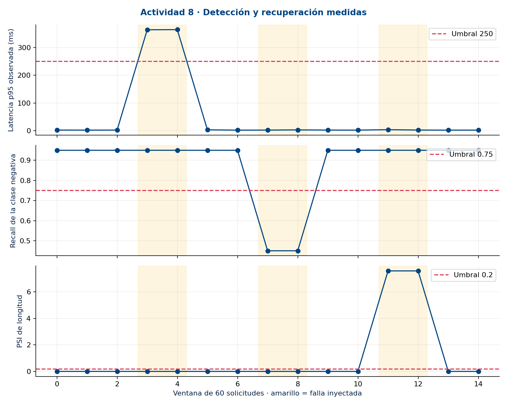

# Actividad 8 · Documentación del proyecto

**Eduardo Aburto Angulo · Observabilidad y continuidad del servicio**

Documentación técnica, evidencia de implementación y resultados de los incidentes simulados del sistema de observabilidad.

[← Volver a la portada](../README.md)

## Recorrido recomendado

| Paso | Documento | Qué encontrarás |
|---|---|---|
| **01 · Entender el diseño** | [Documento técnico](01-documento-tecnico/README.md) | Indicadores, alertas, SLO, presupuesto de error, dashboards, runbooks y drift. |
| **02 · Revisar la evidencia** | [Evidencia de implementación](02-evidencia-implementacion/README.md) | Gráficas, capturas de Streamlit y MLflow, trazabilidad y exportaciones. |
| **03 · Evaluar la respuesta** | [Simulación de incidentes](03-simulacion-incidentes/README.md) | Latencia, degradación de calidad y drift: detección, intervención y recuperación. |

## El resultado en una vista

| Indicador | Resultado y lectura correcta |
|---|---|
| Solicitudes | 900 solicitudes HTTP reales en un laboratorio local |
| Incidentes | Tres fallas simuladas, detectadas y recuperadas |
| Disponibilidad | 900/900 solicitudes exitosas |
| Presupuesto de latencia | 120 solicitudes lentas frente a 9 permitidas: **SLO incumplido** |
| Alcance | Recuperación local comprobada; no validación de producción bancaria |

Recuperar el servicio no borra el presupuesto consumido. El modelo clasifica noticias en inglés; no predice rendimientos ni ejecuta inversiones.

## Consultar la evidencia original

[Resumen de la corrida](../evidencias/summary.json) · [Registro MLflow](../evidencias/mlflow_export.json) · [Análisis por incidente](../evidencias/incident_analysis.json) · [Runbooks operativos](../runbooks/README.md)

Descargas para entrega académica y edición

| Entregable | PDF | Word |
|---|---|---|
| Documento técnico | [Descargar](Documento_tecnico.pdf) | [Editar](Documento_tecnico.docx) |
| Evidencia de implementación | [Descargar](Evidencia_implementacion.pdf) | [Editar](Evidencia_implementacion.docx) |
| Simulación de incidentes | [Descargar](Simulacion_incidentes.pdf) | [Editar](Simulacion_incidentes.docx) |

Las descargas conservan la edición académica original. La versión README sustituye su uso como ruta principal de lectura; mantiene resultados, salvedades, referencias y declaración de IA.

**La IA no sustituye el criterio del banquero; lo aumenta.**
